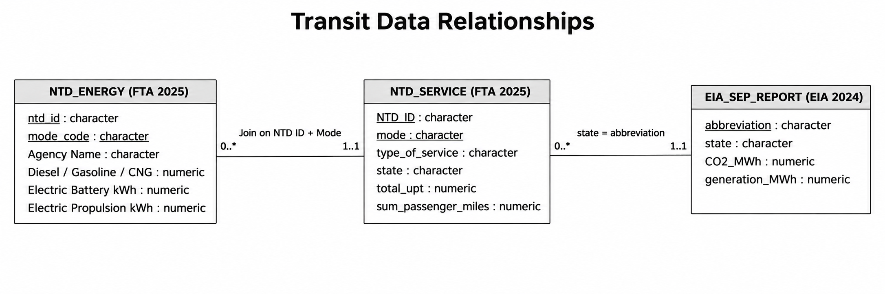

<!-- STUDENT WRITING REQUIRED. Per STA 9750 policy, do not use AI-written non-code prose. -->
<!-- Replace this comment with your own opening press-release paragraphs. -->

## Data acquisition and preparation

```{r}
#| label: setup
library(tidyverse)
library(httr2)
library(rvest)
library(readxl)
library(fs)
library(knitr)
library(scales)

# Original data and methods:
# https://michael-weylandt.com/STA9750/mini/mini02.html
# https://www.eia.gov/environment/emissions/CO2_vol_mass.php
# https://www.transit.dot.gov/ntd/national-transit-database-ntd-glossary
# https://www.transit.dot.gov/sites/fta.dot.gov/files/2025-09/2025-NTD-Full-Policy-Manual.pdf

DATA_DIR <- fs::path("data", "mp02")
fs::dir_create(DATA_DIR, recurse = TRUE)
```

```{r}
#| label: eia-import
# EIA 2024 State Electricity Profiles, as reproduced in the professor's
# assignment. One published summary table avoids EIA's 50-request throttle.
# Source: https://michael-weylandt.com/STA9750/mini/mini02.html
# Original data: https://www.eia.gov/electricity/state/

load_eia_from_course <- function() {
  path <- fs::path(DATA_DIR, "instructor_eia_2024.html")

  parse_course_table <- function(file) {
    tables <- rvest::read_html(file) |>
      rvest::html_elements("table") |>
      purrr::map(~rvest::html_table(.x, fill = TRUE))

    # Identify the particular 50-state EIA summary, not other page tables.
    candidates <- which(purrr::map_lgl(tables, function(x) {
      any(stringr::str_detect(names(x),
        stringr::fixed("Pounds of CO2 Emitted Per MWh")), na.rm = TRUE)
    }))
    if (length(candidates) == 0) {
      stop("Could not find the EIA summary table on the assignment page.")
    }

    tbl <- tables[[candidates[1]]]
    if (ncol(tbl) != 5) {
      stop("The instructor's EIA summary table changed its columns.")
    }

    names(tbl) <- c("CO2_MWh", "primary_source", "electricity_price_MWh",
                    "generation_MWh", "state_label")

    tbl |>
      dplyr::transmute(
        CO2_MWh = readr::parse_number(as.character(CO2_MWh)),
        primary_source = stringr::str_squish(as.character(primary_source)),
        electricity_price_MWh = readr::parse_number(
          as.character(electricity_price_MWh)),
        generation_MWh = readr::parse_number(as.character(generation_MWh)),
        state = stringr::str_remove(as.character(state_label),
                 "\\s*\\([A-Z]{2}\\)\\s*$"),
        abbreviation = stringr::str_match(as.character(state_label),
                 "\\(([A-Z]{2})\\)")[, 2]
      )
  }

  # Reject a cached error or incomplete HTML page rather than trusting it.
  cached <- if (fs::file_exists(path)) {
    tryCatch(parse_course_table(path), error = function(e) NULL)
  } else NULL

  if (!is.null(cached) && nrow(cached) == 50) return(cached)
  if (fs::file_exists(path)) fs::file_delete(path)

  httr2::request("https://michael-weylandt.com/STA9750/mini/mini02.html") |>
    httr2::req_headers(`User-Agent` = "Mozilla/5.0") |>
    httr2::req_retry(max_tries = 3) |>
    httr2::req_perform(path)

  parse_course_table(path)
}

EIA_SEP_REPORT <- load_eia_from_course()
stopifnot(nrow(EIA_SEP_REPORT) == 50,
          setequal(EIA_SEP_REPORT$abbreviation, state.abb),
          !anyNA(EIA_SEP_REPORT[, c("CO2_MWh", "primary_source",
                                   "electricity_price_MWh", "generation_MWh")]))
```

```{r}
#| label: ntd-energy-import
# FTA 2025 NTD Annual Database Energy Consumption.
# If the instructor's Excel file is already cached, use it. Otherwise download
# the *same* official FTA dataset from the DOT's Socrata CSV mirror.
# Dataset: https://data.transportation.gov/d/f432-ajba
# Published column metadata:
# https://data.transportation.gov/api/views/f432-ajba/columns.json
load_ntd_energy <- function() {
  xlsx_path <- fs::path(DATA_DIR, "2025_ntd_energy.xlsx")
  csv_path <- fs::path(DATA_DIR, "2025_ntd_energy_api.csv")

  # Use a valid Excel cache only. If the cached file is an HTTP error page,
  # ignore it and load the official CSV instead.
  excel_cache <- if (fs::file_exists(xlsx_path) &&
                     file.info(xlsx_path)$size > 1e4) {
    tryCatch(readxl::read_excel(xlsx_path), error = function(e) NULL)
  } else NULL
  if (!is.null(excel_cache)) {
    raw <- excel_cache
  } else {
    # Download once, then use cached CSV in subsequent renders.
    if (!fs::file_exists(csv_path) || file.info(csv_path)$size < 1e4) {
      if (fs::file_exists(csv_path)) fs::file_delete(csv_path)

      # Socrata defaults to 1,000 rows unless a larger limit is requested.
      url <- "https://data.transportation.gov/resource/f432-ajba.csv"
      temp <- paste0(csv_path, ".part")
      if (fs::file_exists(temp)) fs::file_delete(temp)
      tryCatch({
        httr2::request(url) |>
          httr2::req_url_query(`$limit` = 50000) |>
          httr2::req_headers(`User-Agent` = "Mozilla/5.0") |>
          httr2::req_retry(max_tries = 3) |>
          httr2::req_perform(temp)
        # Avoid accepting HTTP error documents as data.
        if (file.info(temp)$size < 1e4) {
          stop("DOT energy CSV is unusually small; download may be incomplete.")
        }
        fs::file_move(temp, csv_path)
      }, error = function(e) {
        if (fs::file_exists(temp)) fs::file_delete(temp)
        stop(paste0(
          "Could not download the official DOT energy CSV. ",
          "You can manually export the CSV from https://data.transportation.gov/d/f432-ajba ",
          "and save it as data/mp02/2025_ntd_energy_api.csv. ",
          "Original error: ", conditionMessage(e)
        ), call. = FALSE)
      })
    }

    # Read as text first so NTD IDs with leading zeros survive import.
    raw <- readr::read_csv(
      csv_path, col_types = readr::cols(.default = readr::col_character()),
      show_col_types = FALSE
    )

    # The Socrata API uses field names; map them back to the original Excel
    # column names so all later sections work unchanged.
    api_names <- c(
      "ntd_id" = "NTD ID",
      "agency_name" = "Agency Name",
      "mode" = "Mode",
      "tos" = "TOS",
      "gallons_of_bio_diesel" = "Gallons of Bio-Diesel",
      "gallons_of_bunker_fuel" = "Gallons of Bunker Fuel",
      "gallons_of_compressed_natural" = "Gallons of Compressed Natural Gas",
      "gallons_of_diesel_fuel" = "Gallons of Diesel Fuel",
      "kilowatt_hours_of_electric" = "Kilowatt hours of Electric Battery",
      "kilowatt_hours_of_electric_1" = "Kilowatt hours of Electric Propulsion",
      "gallons_of_ethanol" = "Gallons of Ethanol",
      "gallons_of_gasoline" = "Gallons of Gasoline",
      "gallons_of_kerosene" = "Gallons of Kerosene",
      "gallons_of_liquified_natural" = "Gallons of Liquified Nat Gas",
      "gallons_of_liquified_petroleum" = "Gallons of Liquified Petroleum Gas",
      "gallons_of_hydrogen" = "Gallons of Hydrogen"
    )
    names(raw) <- dplyr::recode(names(raw), !!!api_names)
  }

  # Spreadsheet column spelling sometimes differs slightly from the CSV.
  names(raw) <- stringr::str_squish(names(raw))

  quantity_cols <- c(
    "Gallons of Bio-Diesel", "Gallons of Bunker Fuel",
    "Gallons of Compressed Natural Gas", "Gallons of Diesel Fuel",
    "Kilowatt hours of Electric Battery",
    "Kilowatt hours of Electric Propulsion",
    "Gallons of Ethanol", "Gallons of Gasoline",
    "Gallons of Kerosene", "Gallons of Liquified Nat Gas",
    "Gallons of Liquified Petroleum Gas"
  )
  required <- c("NTD ID", "Agency Name", "Mode", quantity_cols)
  missing_cols <- setdiff(required, names(raw))
  if (length(missing_cols)) {
    stop("Energy source schema differs from expected. Missing: ",
         paste(missing_cols, collapse = ", "), call. = FALSE)
  }

  raw |>
    dplyr::mutate(
      across(all_of(c("NTD ID", "Agency Name", "Mode")), as.character),
      across(all_of(quantity_cols),
        ~tidyr::replace_na(
          suppressWarnings(readr::parse_number(as.character(.x))), 0))
    ) |>
    dplyr::group_by(`NTD ID`, Mode, `Agency Name`) |>
    dplyr::summarise(across(all_of(quantity_cols), sum), .groups = "drop") |>
    dplyr::filter(if_any(all_of(quantity_cols), ~ .x > 0))
}

NTD_ENERGY <- load_ntd_energy()
stopifnot(nrow(NTD_ENERGY) > 100)
```

```{r}
#| label: ntd-service-import
# Instructor-provided Socrata query, adapted for caching and robust numeric types.
load_ntd_service <- function() {
  path <- fs::path(DATA_DIR, "2025_ntd_service.csv")
  if (!fs::file_exists(path)) {
    query <- paste(
      "SELECT `_5_digit_ntd_id` AS `NTD_ID`",
      "`max_agency` AS `AGENCY`",
      "`max_reporter_type` AS `reporter_type`",
      "`max_organization_type` AS `organization_type`",
      "`max_city` AS `city`",
      "`max_state` AS `state`",
      "`mode`",
      "`type_of_service`",
      "`max_primary_uza_code` AS `uza_code`",
      "`max_primary_uza_name` AS `uza_name`",
      "`max_primary_uza_area_sq_miles` AS `uza_sq_miles`",
      "`max_primary_uza_population` AS `uza_population`",
      "`max_service_area_sq_miles` AS `service_area_sq_miles`",
      "`max_service_area_population` AS `service_area_population`",
      "`questionable_record` AS `flagged_likely_inaccurate`",
      "`sum_unlinked_passenger_trips_upt` AS `total_upt`",
      "`sum_passenger_miles` WHERE caseless_one_of(`report_year`, '2025') LIMIT 50000",
      sep = ", "
    )
    httr2::request("https://data.transportation.gov/resource/4fir-qbim.csv") |>
      httr2::req_url_query(`$query` = query) |>
      httr2::req_headers(`User-Agent` = "Mozilla/5.0") |>
      httr2::req_retry(max_tries = 4) |>
      httr2::req_perform(path)
  }
  if (file.info(path)$size < 1e4) {
    stop("Service download appears incomplete. Delete data/mp02/2025_ntd_service.csv and retry.")
  }
  readr::read_csv(path, show_col_types = FALSE) |>
    mutate(flagged_likely_inaccurate = !is.na(flagged_likely_inaccurate))
}

NTD_SERVICE <- load_ntd_service()
```

```{r}
#| label: mode-code-recoding
# Based on the FTA's NTD Glossary. Retain original codes for the joins.
mode_names <- c(
  "AR" = "Alaska Railroad", "CB" = "Commuter Bus",
  "CC" = "Cable Car", "CR" = "Commuter Rail",
  "DR" = "Demand Response", "DT" = "Demand Taxi",
  "FB" = "Ferryboat", "HR" = "Heavy Rail",
  "IP" = "Inclined Plane", "JT" = "Jitney",
  "LR" = "Light Rail", "MB" = "Bus",
  "MG" = "Monorail/Automated Guideway", "PB" = "Publico",
  "RB" = "Bus Rapid Transit", "SR" = "Streetcar",
  "TB" = "Trolleybus", "TR" = "Aerial Tramway",
  "VP" = "Vanpool", "YR" = "Hybrid Rail"
)

NTD_ENERGY <- NTD_ENERGY |>
  mutate(
    ntd_id = str_pad(as.character(`NTD ID`), 5, pad = "0"),
    mode_code = as.character(Mode),
    Mode = recode(as.character(Mode), !!!mode_names, .default = "Unknown")
  )

NTD_SERVICE <- NTD_SERVICE |>
  mutate(
    ntd_id = str_pad(as.character(NTD_ID), 5, pad = "0"),
    mode_code = as.character(mode),
    state = toupper(state),
    total_upt = as.numeric(total_upt),
    sum_passenger_miles = as.numeric(sum_passenger_miles)
  )

# Print unexpected mode codes as an audit check.
unmapped_modes <- NTD_ENERGY |>
  filter(Mode == "Unknown") |>
  distinct(mode_code)

stopifnot(nrow(unmapped_modes) == 0)
```

<!-- STUDENT WRITING: Describe the three data sources and explain your join keys in your own words. -->
## Extra Credit: Data Relationship Diagram

{width="100%"}

## Exploratory data analysis (eight selected questions)

### EIA electricity profiles

```{r}
#| label: eda-expensive-power
#| fig-cap: "Five states with highest average retail electricity prices. Source: EIA state electricity profiles."
EIA_SEP_REPORT |>
  slice_max(electricity_price_MWh, n = 5, with_ties = FALSE) |>
  ggplot(aes(x = reorder(state, electricity_price_MWh),
             y = electricity_price_MWh)) +
  geom_col(fill = "#166b65", width = 0.7) +
  geom_text(aes(label = scales::dollar(electricity_price_MWh, accuracy = 0.01)),
            hjust = -0.08, size = 3.7) +
  coord_flip() +
  scale_y_continuous(labels = scales::dollar, expand = expansion(mult = c(0, 0.20))) +
  labs(title = "Highest retail electricity costs", subtitle = "Five most expensive states",
       x = NULL, y = "Dollars per MWh",
       caption = "Source: U.S. Energy Information Administration, state electricity profiles") +
  theme_minimal(base_size = 12) +
  theme(panel.grid.major.y = element_blank(), plot.title = element_text(face = "bold"))
```

```{r}
#| label: eda-dirtiest-electricity
EIA_SEP_REPORT |>
  slice_max(CO2_MWh, n = 5, with_ties = FALSE) |>
  transmute(State = state, `Primary source` = primary_source,
            `CO2 per MWh (lbs)` = scales::comma(CO2_MWh)) |>
  knitr::kable(caption = "Five states with the highest electricity CO2 intensity (EIA)")
```

```{r}
#| label: eda-inline-electricity
us_weighted_co2 <- with(EIA_SEP_REPORT,
                        weighted.mean(CO2_MWh, generation_MWh, na.rm = TRUE))
ny_tx_ratio <- EIA_SEP_REPORT |>
  filter(abbreviation %in% c("NY", "TX")) |>
  summarize(ratio = CO2_MWh[abbreviation == "TX"] /
              CO2_MWh[abbreviation == "NY"]) |>
  pull(ratio)
```

<!-- STUDENT WRITING: Write your own sentences around these inline values. -->

**Weighted-average U.S. electricity intensity:** `r scales::number(us_weighted_co2, accuracy = 0.1)` lbs CO2/MWh.

**Texas/New York electricity intensity ratio:** `r scales::number(ny_tx_ratio, accuracy = 0.01)`.

High electricity prices don't mean high carbon emissions per MWh. With the exception of Hawaii, a petroleum-reliant state, the most expensive states, like California and Massachusetts, are absent from the list of states with the highest electricity carbon intensity, which is dominated by states with coal as their primary source. Therefore transit agencies in states with cleaner energy should most likely be greener, despite the higher power cost. 

### NTD energy consumption

```{r}
#| label: eda-largest-fuel-using-agencies
fuel_cols <- names(NTD_ENERGY) |> stringr::str_subset("^Gallons of ")
agency_gallons <- NTD_ENERGY |>
  group_by(ntd_id, `Agency Name`) |>
  summarize(across(all_of(fuel_cols), ~sum(.x, na.rm = TRUE)), .groups = "drop") |>
  mutate(total_gallons = rowSums(across(all_of(fuel_cols))))

top_fuel_agencies <- agency_gallons |>
  slice_max(total_gallons, n = 5, with_ties = FALSE)

top_fuel_agencies |>
  select(`Agency Name`, all_of(fuel_cols)) |>
  pivot_longer(-`Agency Name`, names_to = "Fuel type", values_to = "Gallons") |>
  filter(Gallons > 0) |>
  mutate(`Fuel type` = str_remove(`Fuel type`, "^Gallons of "),
         Gallons = scales::comma(round(Gallons))) |>
  knitr::kable(caption = "Fuel mix for the five transit agencies using the most gallons (FTA NTD)")
```

```{r}
#| label: eda-least-common-fuel
fuel_totals <- agency_gallons |>
  summarize(across(all_of(fuel_cols), ~sum(.x, na.rm = TRUE))) |>
  pivot_longer(everything(), names_to = "fuel", values_to = "gallons") |>
  arrange(gallons)
least_common_fuel <- fuel_totals |>
  filter(gallons > 0) |>
  slice_min(gallons, n = 1, with_ties = FALSE) |>
  pull(fuel)
```

<!-- STUDENT WRITING: Interpret volume as gallons, not as gallons plus kilowatt-hours. -->

**Least-used reported gallon-based fuel:** `r least_common_fuel`.

Transit agencies rely on different fuel types, for example New Jersey Transit Corporation and MTA New York City Transit have Diesel Fuel as their primary fuel type. On the other hand, Los Angeles County Metropolitan Transportation Authority has Compressed Natural Gas as their primary fuel type. As a result, we have to convert raw fuel consumption into total CO2 emissions, since fuel types pollute differently, in order to have a fair comparison. 

### NTD passenger service

```{r}
#| label: service-by-agency-mode
# Service can contain multiple type-of-service rows for a single agency/mode.
# Aggregate those rows BEFORE joining to the energy dataset.
SERVICE_MODE <- NTD_SERVICE |>
  filter(!flagged_likely_inaccurate) |>
  group_by(ntd_id, mode_code) |>
  summarize(
    agency = first(AGENCY),
    state = first(state),
    total_upt = sum(total_upt, na.rm = TRUE),
    passenger_miles = sum(sum_passenger_miles, na.rm = TRUE),
    .groups = "drop"
  )
stopifnot(!anyDuplicated(SERVICE_MODE[c("ntd_id", "mode_code")]))
```

```{r}
#| label: eda-busiest-services
#| fig-width: 11
#| fig-height: 6.5
#| fig-cap: "Five agency/mode combinations with the most unlinked passenger trips (2025 NTD)."
SERVICE_MODE |>
  slice_max(total_upt, n = 5, with_ties = FALSE) |>
  mutate(
  label = paste0(agency, " [", mode_code, "]"),
  label = str_wrap(label, width = 34)
) |>
  ggplot(aes(x = reorder(label, total_upt), y = total_upt / 1e6)) +
  geom_col(fill = "#166b65", width = 0.7) +
  geom_text(aes(label = scales::comma(round(total_upt / 1e6))),
            hjust = -0.1, size = 3.6) +
  coord_flip() +
  scale_y_continuous(expand = expansion(mult = c(0, 0.18))) +
  labs(title = "America's busiest transit services",
       subtitle = "Individual transit modes ranked by annual unlinked passenger trips",
       x = NULL, y = "Millions of annual unlinked passenger trips",
       caption = "Source: FTA National Transit Database, 2025 Service by Agency") +
  theme_minimal(base_size = 12) +
  theme(panel.grid.major.y = element_blank(), plot.title = element_text(face = "bold"))
```

```{r}
#| label: eda-missing-states
missing_state_codes <- tibble(state = state.abb) |>
  anti_join(NTD_SERVICE |> distinct(state), by = "state") |>
  pull(state)
missing_states <- if (length(missing_state_codes) == 0) {
  "None"
} else {
  paste(state.name[match(missing_state_codes, state.abb)], collapse = ", ")
}
```

<!-- STUDENT WRITING: Add your own interpretation of coverage. -->

**States missing from the service data:** `r missing_states`.

Ridership volume varies widely between agencies, for example, the MTA New York City Transit HR has more annual unlinked passenger trips than the rest of the top five combined. As a result, the MTA New York City Transit will consume a lot more energy, thus most likely creating greater CO2 emissions. Therefore, we have to normalize CO2 emissions by passenger activity to compare agencies fairly. 

## Estimating direct and electricity-related CO2 emissions

```{r}
#| label: emissions-calculations
# Fuel factors are approximate pounds of CO2 per reported gallon.
# Direct gasoline/diesel/kerosene/propane/residual-oil factors: EIA (2024).
# CNG is modeled as a gasoline-gallon equivalent: 123.57 scf/GGE
# times 120.85 lb per 1000 scf, using EIA and DOE AFDC sources.
# LNG uses DOE's 0.66 GGE per physical gallon, multiplied by CNG lb/GGE.
# Biodiesel treated as diesel-equivalent direct combustion, as a proxy.
# Ethanol/hydrogen set to 0 FOSSIL direct CO2, not 0 lifecycle CO2.
# See limitations; upstream production, land-use and vehicle construction omitted.

lbs_per_gallon <- c(
  biodiesel = 22.45,
  bunker = 24.78,
  cng = 123.57 * 120.85 / 1000,
  diesel = 22.45,
  ethanol = 0,
  gasoline = 18.73,
  kerosene = 21.78,
  lng = 0.66 * 123.57 * 120.85 / 1000,
  lpg = 12.68
)

# Ensure all three datasets connect without accidental many-to-many expansion.
EIA_STATE <- EIA_SEP_REPORT |>
  select(abbreviation, CO2_MWh)

TRANSIT_MODE_EMISSIONS <- NTD_ENERGY |>
  left_join(SERVICE_MODE,
            by = join_by(ntd_id, mode_code), relationship = "one-to-one") |>
  left_join(EIA_STATE,
            by = join_by(state == abbreviation), relationship = "many-to-one") |>
  mutate(
    electric_kwh = `Kilowatt hours of Electric Battery` +
                   `Kilowatt hours of Electric Propulsion`,
    electricity_emissions_lbs = electric_kwh / 1000 * CO2_MWh,
    fuel_emissions_lbs =
      `Gallons of Bio-Diesel` * lbs_per_gallon[["biodiesel"]] +
      `Gallons of Bunker Fuel` * lbs_per_gallon[["bunker"]] +
      `Gallons of Compressed Natural Gas` * lbs_per_gallon[["cng"]] +
      `Gallons of Diesel Fuel` * lbs_per_gallon[["diesel"]] +
      `Gallons of Ethanol` * lbs_per_gallon[["ethanol"]] +
      `Gallons of Gasoline` * lbs_per_gallon[["gasoline"]] +
      `Gallons of Kerosene` * lbs_per_gallon[["kerosene"]] +
      `Gallons of Liquified Nat Gas` * lbs_per_gallon[["lng"]] +
      `Gallons of Liquified Petroleum Gas` * lbs_per_gallon[["lpg"]],
    total_emissions_lbs = electricity_emissions_lbs + fuel_emissions_lbs
  )

# Inspect lost coverage before omitting records without usable service/grid data.
coverage_audit <- TRANSIT_MODE_EMISSIONS |>
  summarize(
    energy_agency_modes = n(),
    no_service_match = sum(is.na(total_upt)),
    no_state_emissions_match = sum(is.na(CO2_MWh)),
    zero_or_missing_miles = sum(is.na(passenger_miles) | passenger_miles <= 0)
  )
knitr::kable(coverage_audit, caption = "Data integration coverage audit")

TRANSIT_MODE_VALID <- TRANSIT_MODE_EMISSIONS |>
  filter(!is.na(total_upt), total_upt > 0,
         !is.na(passenger_miles), passenger_miles > 0,
         !is.na(total_emissions_lbs), is.finite(total_emissions_lbs))

# Agency totals are calculated after combining the agency's modes.
AGENCY_EMISSIONS <- TRANSIT_MODE_VALID |>
  group_by(ntd_id) |>
  summarize(
    agency = first(agency),
    state = first(state),
    modes = n(),
    total_upt = sum(total_upt),
    passenger_miles = sum(passenger_miles),
    fuel_emissions_lbs = sum(fuel_emissions_lbs),
    electricity_emissions_lbs = sum(electricity_emissions_lbs),
    total_emissions_lbs = sum(total_emissions_lbs),
    .groups = "drop"
  ) |>
  mutate(
    lbs_per_upt = total_emissions_lbs / total_upt,
    lbs_per_passenger_mile = total_emissions_lbs / passenger_miles
  )

stopifnot(nrow(AGENCY_EMISSIONS) > 0,
          all(is.finite(AGENCY_EMISSIONS$lbs_per_upt)),
          all(is.finite(AGENCY_EMISSIONS$lbs_per_passenger_mile)),
          all(AGENCY_EMISSIONS$total_emissions_lbs >= 0))
```

<!-- STUDENT WRITING: Explain what factors were used and note limits of the model. -->
<!-- Suggested checks: matched agencies, states excluded, fleet composition, hydrogen and biofuels, year mismatch. -->

## Award calculations

```{r}
#| label: award-winners
# Eligibility filters limit small-denominator and sparse-service outliers.
# Award 1: "Greenest Transit Agency" -- lowest lbs CO2 per passenger-mile.
# Award 2 (original): "Low-Carbon Trip Champion" -- lowest lbs CO2
# per unlinked passenger trip among agencies with at least 10 million trips.

GREENEST_POOL <- AGENCY_EMISSIONS |>
  filter(total_upt >= 1e6, passenger_miles >= 5e6,
         total_emissions_lbs > 0)
TRIP_POOL <- AGENCY_EMISSIONS |>
  filter(total_upt >= 1e7, passenger_miles >= 5e6,
         total_emissions_lbs > 0)

stopifnot(nrow(GREENEST_POOL) > 0, nrow(TRIP_POOL) > 0)

greenest_winner <- GREENEST_POOL |>
  slice_min(lbs_per_passenger_mile, n = 1, with_ties = FALSE)
trip_winner <- TRIP_POOL |>
  slice_min(lbs_per_upt, n = 1, with_ties = FALSE)

greenest_median <- median(GREENEST_POOL$lbs_per_passenger_mile)
trip_median <- median(TRIP_POOL$lbs_per_upt)

award_summary <- bind_rows(
  greenest_winner |>
    transmute(Award = "Greenest Transit Agency",
              `Winning agency` = agency,
              `Winner metric` = lbs_per_passenger_mile,
              `Median eligible agency` = greenest_median,
              `Eligible agencies` = nrow(GREENEST_POOL)),
  trip_winner |>
    transmute(Award = "Low-Carbon Trip Champion",
              `Winning agency` = agency,
              `Winner metric` = lbs_per_upt,
              `Median eligible agency` = trip_median,
              `Eligible agencies` = nrow(TRIP_POOL))
) |>
  mutate(across(c(`Winner metric`, `Median eligible agency`),
                ~round(.x, 4)))

knitr::kable(award_summary,
             caption = "Award winners and comparison values; units are lbs CO2 per passenger-mile or trip")
```

## Press release:

<!-- INTRODUCTION-->

As the executive director of the Green Transit Alliance (GTA) I'm elated to present this year's awards. We will recognize U.S. public transportation agencies' green efforts in lowering their carbon dioxide (CO2) emissions caused by their fuel combustion. In order to do this we will be using Federal Transit Administration (FTA) and U.S. Energy Information Administration (EIA) data to estimate and compare emissions. Evaluation will be done through CO2 per passenger-mile and CO2 per passenger trip metrics with the lower end indicating better performance. 


<!-- STUDENT: Announce Award 1 with metric, winning agency, value and median. -->


The Greenest Transit Agency award goes to the agency that has the lowest estimated CO2 emissions per passenger-mile (one passenger traveling one mile). Lower emissions per passenger-mile demonstrate greater carbon efficiency. The winner is Anaheim Transportation Network (aka Anaheim Regional Transportation) located in Anaheim, California with an estimated `r scales::number(greenest_winner$lbs_per_passenger_mile, accuracy = 0.0001)` pounds of CO2 per passenger-mile. Anaheim Transportation Network had the lowest estimated value of CO2 emissions per passenger-mile across `r nrow(GREENEST_POOL)` agencies and was approximately `r scales::percent(1 - greenest_winner$lbs_per_passenger_mile / greenest_median, accuracy = 0.1)` lower than the `r scales::number(greenest_median, accuracy = 0.0001)` pounds of CO2 per passenger-mile median.


```{r}
#| label: award-chart-greenest
#| fig-width: 11
#| fig-height: 7.2
#| fig-cap: "Lower emissions per passenger-mile is better. Top ten eligible agencies, with median of all eligible agencies. Sources: FTA NTD (2025), EIA state electricity profiles, EIA CO2 conversion factors."
GREENEST_POOL |>
  slice_min(lbs_per_passenger_mile, n = 10, with_ties = FALSE) |>
  mutate(agency_label = str_wrap(agency, width = 32)) |>
  ggplot(aes(x = reorder(agency_label, lbs_per_passenger_mile),
             y = lbs_per_passenger_mile)) +
  geom_col(fill = "#166b65", width = 0.68) +
  geom_hline(yintercept = greenest_median, linetype = "dashed",
             color = "#B88B48", linewidth = 0.85) +
  coord_flip() +
  scale_y_continuous(labels = scales::number_format(accuracy = 0.01),
                     expand = expansion(mult = c(0, 0.08))) +
  labs(title = "Greenest transit agencies by passenger-mile",
       subtitle = "Ten lowest-emission agencies (minimum 1M annual trips, 5M passenger-miles)",
       x = NULL, y = "Pounds of CO2 per passenger-mile",
       caption = paste0("Dashed line: eligible-agency median (",
                        round(greenest_median, 3), " lbs). Sources: FTA NTD 2025, EIA.")) +
  theme_minimal(base_size = 12) +
  theme(panel.grid.major.y = element_blank(),
        plot.title = element_text(face = "bold"),
        plot.caption = element_text(hjust = 0))
```

<!-- STUDENT: Announce Award 2 (original), define its different metric, explain eligibility, winner and median. -->

The Low-Carbon Trip Champion award goes to the agency that has the lowest estimated CO2 emissions per passenger trip (one passenger taking one trip on public transportation). Unlike the Greenest Transit Agency award this award measures emissions per passenger trip, regardless of distance. The winner is Tri-County Metropolitan Transportation District of Oregon (aka TriMet) located in Oregon with an estimated `r scales::number(trip_winner$lbs_per_upt, accuracy = 0.0001)` pounds of CO₂ per passenger trip. Tri-County had the lowest estimated value of CO₂ per passenger trip across `r nrow(TRIP_POOL)` agencies and was approximately `r scales::percent(1 - trip_winner$lbs_per_upt / trip_median, accuracy = 0.1)` lower than the `r scales::number(trip_median, accuracy = 0.0001)` pounds of CO₂ per passenger trip median.


```{r}
#| label: award-chart-trips
#| fig-width: 11
#| fig-height: 7.2
#| fig-cap: "Lower CO2 per unlinked passenger trip is better. Sources: FTA NTD (2025), EIA state electricity profiles and CO2 conversion factors."
TRIP_POOL |>
  slice_min(lbs_per_upt, n = 10, with_ties = FALSE) |>
  mutate(agency_label = str_wrap(agency, width = 32)) |>
  ggplot(aes(x = reorder(agency_label, lbs_per_upt),
             y = lbs_per_upt)) +
  geom_col(fill = "#166b65", width = 0.68) +
  geom_hline(yintercept = trip_median, linetype = "dashed",
             color = "#B88B48", linewidth = 0.85) +
  coord_flip() +
  scale_y_continuous(labels = scales::number_format(accuracy = 0.01),
                     expand = expansion(mult = c(0, 0.08))) +
  labs(title = "Low-carbon trip champions",
       subtitle = "Ten lowest-emission agencies (minimum 10M annual unlinked passenger trips)",
       x = NULL, y = "Pounds of CO2 per passenger trip",
       caption = paste0("Dashed line: eligible-agency median (",
                        round(trip_median, 3), " lbs). Sources: FTA NTD 2025, EIA.")) +
  theme_minimal(base_size = 12) +
  theme(panel.grid.major.y = element_blank(),
        plot.title = element_text(face = "bold"),
        plot.caption = element_text(hjust = 0))
```

<!-- STUDENT: Add YOUR OWN closing paragraphs including uncertainty and relevant policy context. -->
<!-- STUDENT: Explain these are direct fossil-combustion + state-average electric generation estimates,
     not lifecycle greenhouse-gas inventories, and not proof of causal car-trip substitution. -->

Emissions were estimated by combining the FTA data (2025) on fuel consumption and passenger service with EIA electricity emissions data (2024). Electricity emissions don't come from each agency's actual electricity source, but rather state averages used as a workaround for this data limitation. Furthermore, some agencies had incomplete or unmatched records, which could have affected our results. We awarded the agencies that performed best against our chosen metrics. These are not holistic awards, nevertheless, Anaheim Regional Transportation and TriMet, can be studied to help identify opportunities to improve carbon efficiency. 


### Extra Credit Award: The Golden Tailpipe Razzie

```{r}
#| label: golden-tailpipe-razzie

# Compare agencies with substantial passenger activity.
# High scores indicate poor performance on both dimensions.
RAZZIE_POOL <- TRIP_POOL |>
  mutate(
    inefficiency_rank = percent_rank(lbs_per_passenger_mile),
    footprint_rank = percent_rank(total_emissions_lbs),
    razzie_score = 100 * (inefficiency_rank + footprint_rank) / 2
  )

# Require above-median emissions intensity AND total footprint.
RAZZIE_CANDIDATES <- RAZZIE_POOL |>
  filter(
    lbs_per_passenger_mile > median(RAZZIE_POOL$lbs_per_passenger_mile),
    total_emissions_lbs > median(RAZZIE_POOL$total_emissions_lbs)
  )

RAZZIE_WINNER <- RAZZIE_CANDIDATES |>
  slice_max(razzie_score, n = 1, with_ties = FALSE)

RAZZIE_WINNER |>
  transmute(
    Agency = agency,
    `CO2 per passenger-mile` = round(lbs_per_passenger_mile, 4),
    `Total CO2 (million lbs)` = round(total_emissions_lbs / 1e6, 2),
    `Double-whammy score` = round(razzie_score, 1)
  ) |>
  knitr::kable(
    caption = "Golden Tailpipe Razzie: estimated carbon performance"
  )
```

```{r}
#| label: razzie-chart
#| fig-width: 10
#| fig-height: 6
#| fig-cap: "Estimated CO2 intensity versus total emissions for eligible transit agencies. Gold identifies the Razzie recipient. Sources: FTA NTD 2025 and EIA 2024."

ggplot(
  RAZZIE_POOL,
  aes(
    x = lbs_per_passenger_mile,
    y = total_emissions_lbs / 1e6
  )
) +
  geom_point(color = "#166b65", alpha = 0.55, size = 2.5) +
  geom_text(
  data = RAZZIE_WINNER,
  aes(label = agency),
  hjust = 1.05,
  vjust = -0.8,
  size = 3.5,
  fontface = "bold",
  color = "#174C3B"
) +
  geom_vline(
    xintercept = median(RAZZIE_POOL$lbs_per_passenger_mile),
    linetype = "dashed",
    color = "#B88B48"
  ) +
  geom_hline(
    yintercept = median(RAZZIE_POOL$total_emissions_lbs) / 1e6,
    linetype = "dashed",
    color = "#B88B48"
  ) +
  geom_point(
    data = RAZZIE_WINNER,
    color = "#B88B48",
    size = 5
  ) +
  labs(
    title = "The Golden Tailpipe Razzie",
    subtitle = "High carbon intensity meets a large carbon footprint",
    x = "Pounds of CO2 per passenger-mile",
    y = "Total CO2 emissions (million pounds)",
    caption = "Gold point: Razzie recipient. Dashed lines: eligible-agency medians."
  ) +
  theme_minimal(base_size = 12) +
  theme(
    panel.grid.minor = element_blank(),
    plot.title = element_text(face = "bold")
  )
```

The Golden Tailpipe Razzie is our award you will not want to be here to pick up, awarded to the agency that pairs a high emissions per passenger-mile and a massive CO2 footprint. A true double whammy, which we award to this year's undisputed carbon champion Washington State Ferries, proudly representing the *second* most important 'Washington' in the country. This agency pumps out 2.4902 pounds of CO2 per passenger-mile and 346.1 million pounds of total estimated CO2. Combining equally weighted percentile rankings from our double whammy metrics the composite score is 92.3 / 100.  Congratulations! 

## Sources and methodology notes

<!-- STUDENT: Compose your own brief source/methodology discussion if needed. -->

- [U.S. Department of Transportation, FTA National Transit Database](https://www.transit.dot.gov/ntd)
- [U.S. Energy Information Administration, State Electricity Profiles](https://www.eia.gov/electricity/state/)
- [U.S. EIA, Carbon Dioxide Emissions Coefficients](https://www.eia.gov/environment/emissions/CO2_vol_mass.php)
- [U.S. Department of Energy, Alternative Fuels Data Center: Gallon Equivalencies](https://afdc.energy.gov/fuels/equivalency-methodology)
- [U.S. FTA, 2025 NTD Policy Manual](https://www.transit.dot.gov/sites/fta.dot.gov/files/2025-09/2025-NTD-Full-Policy-Manual.pdf)

::: {.callout-note title="AI Usage Statement" collapse="true"}

GenAI (ChatGPT) was used to assist with code, troubleshooting (HTTP 403 errors and quarto render bug), and research (explaining concepts). I used it to walk me through how change the theme and also to explain stat concepts. However, ALL of the writing, such as explanations, interpretations, and jokes were done without AI.
:::
